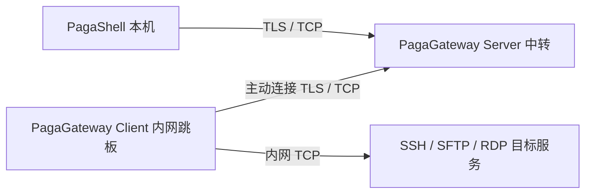

# PagaGateway

[PagaShell](https://github.com/mingdraw/PagaShell) 的 **Page 自定义网关**，Go 标准库实现。一个可执行文件包含 Server 与 Client，支持 Linux / macOS / Windows 的 amd64、arm64。

## 与 PagaShell 的关系

- **PagaShell**：本机桌面工具，管理服务、验证目标 SSH 密钥/RDP 证书并登录；网关类型选择 **Page**。
- **PagaGateway Server**：部署在本机和内网跳板都能访问的中转机器，只开放一个 TCP 端口（示例 `7443`）。
- **PagaGateway Client**：部署在能访问目标服务的内网机器，主动连接 Server，从内网拨号目标。该机器无需开放入站端口，也不要求安装 SSH 服务。
- 项目独立维护于 [mingdraw/PagaGateway](https://github.com/mingdraw/PagaGateway)，PagaShell 内置 Page 协议，用户本机无需额外运行 Go Client。



适合本机与目标网络不互通、双方都能访问一台中转机的场景。没有共同可达的 Server 时不能建立通道。借鉴 [frp](https://github.com/fatedier/frp) 的反向连接和工作连接思路，使用独立的 **Page v1** 协议，不兼容 frps/frpc 的线协议与配置。当前只提供 TCP。

## 快速部署

从本仓库构建或使用发布包内的 `pagagateway`（Windows 为 `pagagateway.exe`）：

```sh
go build -trimpath -o pagagateway ./cmd/pagagateway
./pagagateway version
```

构建要求 Go 1.24+，CI 使用 Go 1.27。JSON 中相对证书路径以启动命令的工作目录为基准；后台进程继承这个目录。

查看可用命令、参数与示例：

```sh
./pagagateway help
./pagagateway server help
./pagagateway client help
./pagagateway certificate help
```

也支持 `-h`、`--help`，例如 `./pagagateway server --help`、`./pagagateway client start -h`；不带参数运行时显示总览帮助。帮助命令无需配置文件或已启动的服务。

### 1. 中转机器运行 Server

```sh
./pagagateway certificate -host relay.example.com
cp examples/server.json server.json
# 编辑 server.json，在 client_token、access_token 中直接填写两枚不同的令牌。
./pagagateway server start -config server.json
```

证书命令生成 `server.crt`、`server.key`，输出公开的 `SHA256:...` 指纹；已存在文件不会覆盖。Server 防火墙放行 TCP `7443`，无需对外暴露每个目标端口。

| 配置 | 使用方 | 用途 |
|---|---|---|
| Server `routes[].client_token` = Client `token` | Server、内网 Client | 注册与回连工作通道 |
| Server `routes[].access_token` = PagaShell 访问令牌 | Server、PagaShell | 访问该 Client 后面的目标 |

令牌直接填写在 JSON 中，不读取环境变量；仅校验非空，不单独限制长度。建议使用随机值并妥善保管配置文件，通过安全渠道分发。同一注册令牌须原样复制到 Server 的 `client_token` 和 Client 的 `token`；每个 route 的两种令牌必须不同。多个内网跳板可添加独立 route、ID 和令牌；修改配置或令牌后重启对应进程。

### 2. 内网跳板运行 Client

复制 `examples/client.json` 为 `client.json`，修改：

```json
{
  "server": "relay.example.com:7443",
  "server_fingerprint": "SHA256:替换为证书命令输出的64位十六进制指纹",
  "id": "office",
  "token": "替换为 Server routes 中的 client_token 值",
  "allowed_targets": ["10.0.0.10:22", "10.0.0.20:3389"],
  "max_tunnels": 128
}
```

```sh
./pagagateway client start -config client.json
```

日志中看到 `Page client registered` 表示登记成功。Client 自动心跳与重连，退避 1–30 秒。控制连接断开会终止所属通道，恢复后由 PagaShell 重连目标；不会重放旧会话。相同 ID 同时只允许一个 Client，重复注册被拒绝。

`allowed_targets` 必填。填写 `["*"]` 表示不限制目标地址和端口，Client 可以连接其网络可达的任意 TCP 服务：

```json
"allowed_targets": ["*"]
```

也可以逐项允许完整、精确的地址和端口，支持 IPv4、域名和 `[IPv6]:端口`；列表中只要包含 `"*"`，即为全放行。不支持局部通配或 CIDR，空列表不会全放行。域名在 Client 网络解析；使用精确列表时，PagaShell 服务地址必须与允许项一致（域名大小写不敏感）。修改后重启 Client。SSH 本地端口转发还受目标 SSH 服务自身的权限控制。

### 3. PagaShell 新建 Page 网关

1. 在「网关」中新建，网关类型选 **Page**。
2. 中转 Server 地址填 `relay.example.com`，端口 `7443`。
3. Client ID 填 `office`，与 Server route 和 Client `id` 一致。
4. 证书模式填写 Server 输出的 SHA-256；无证书 TCP 模式留空。
5. 访问令牌填 Server 对应 route 的 **`access_token` 值**，加密保存在本机保险库。
6. 在目标服务「高级选项 → 网关」选择此网关，服务地址填 Client 能访问的内网地址，例如 `10.0.0.10:22` 或 RDP 的 `10.0.0.20:3389`。

目标服务用户名、密码/私钥仍属于目标服务。PagaShell 在隧道内独立验证目标 SSH 密钥/RDP 证书，随后认证；Server/Client 不代管目标登录凭据。SSH 终端、SFTP、状态采集、本地端口转发和 RDP 共用此传输。

### Windows PowerShell

```powershell
# 编辑 client.json，直接填写 token，再运行：
.\pagagateway.exe client start -config client.json
# 中转机器编辑 server.json 的 client_token、access_token，再运行：
.\pagagateway.exe server start -config server.json
```

### 无证书 TCP 模式（IP 直连）

Server 配置中同时省略 `cert_file`、`key_file`，或将两项都设为 `""`，即可监听未加密的 TCP。仅填写其中一项会报配置错误。可使用 `examples/server-tcp.json`、`examples/client-tcp.json`：

```sh
# 中转机器：编辑令牌和监听地址后启动，无需生成证书
./pagagateway server run -config examples/server-tcp.json
# 内网跳板：将 server 改为中转机器的 IP:端口，并填写相同的 client_token
./pagagateway client run -config examples/client-tcp.json
```

Client 的 `server_fingerprint` 留空或省略；PagaShell 网关地址填写 Server 的 IP（例如 `192.168.1.10`），证书指纹留空，其余 Client ID、访问令牌与目标服务配置照常填写。`run` 可替换为 `start` 在后台运行。

> WARNING: TLS is disabled. Traffic and tokens are sent in plaintext, and the server identity is not verified. Use only on trusted networks.

上述英文风险提示仅由 Server 在无证书模式启动时输出；后台模式同时显示在 Server 的启动或重启命令输出和 `server.log` 中。两条到 Server 的链路须使用相同模式：有证书的 Server 对应非空指纹，无证书的 Server 对应空指纹。填写指纹后的 TLS 失败不会自动切换为明文。目标 SSH 密钥、RDP 证书仍由 PagaShell 独立核验。

### 前台运行

Server 和 Client 均支持前台、后台两种运行方式。`run` 在当前进程中持续运行，适合终端调试或由进程管理工具直接管理：

```sh
./pagagateway server run -config server.json
./pagagateway client run -config client.json
```

日志写入标准错误，进程管理工具可以直接捕获；前台模式不创建默认日志或后台状态文件。Ctrl+C 可停止，Linux/macOS 的 SIGTERM 同样触发连接清理，正常停止退出码为 `0`；配置或监听失败返回非零退出码。Client 连接中断时保持运行并自动重连。

省略 `run` 的原有前台命令同样支持：

```sh
./pagagateway server -config server.json
./pagagateway client -config client.json
```

### 后台运行与管理

Linux、macOS、Windows 均支持 `start`、`status`、`stop`、`restart`。`start` 成功后命令立即返回，关闭终端后进程继续运行；无需额外添加 `nohup` 或 `&`。

```sh
# 中转机器
./pagagateway server start -config server.json
./pagagateway server status
./pagagateway server clients
# 修改 server.json 后重启，重新加载配置
./pagagateway server restart
./pagagateway server stop

# 内网跳板
./pagagateway client start -config client.json
./pagagateway client status
# 修改 client.json 后重启，重新加载配置
./pagagateway client restart
./pagagateway client stop

# 查看默认日志（Linux/macOS）
tail -f server.log
tail -f client.log
```

Windows PowerShell 将 `./pagagateway` 替换为 `.\pagagateway.exe`，命令参数相同；用 `Get-Content .\client.log -Tail 50 -Wait` 查看日志。

`start` 在配置验证完成后返回；Server 此时已经监听，Client 的连接与注册状态可通过日志查看。重复启动同一实例会报错；启动失败会提示日志位置。`stop` 等待所属连接清理后返回。`status`、`restart` 在实例未运行或无法响应时返回非零退出码；未运行时重复 `stop` 会提示未运行并成功退出。

`status`、`stop`、`restart` 使用启动服务的用户和同一路径的可执行文件，自动定位对应的后台 Server 或 Client，不需要 `-config`。查询与管理命令可从其他目录执行，启动时指定了自定义状态文件也可自动定位。`status` 显示运行实例的 PID、配置和日志路径；`status`、`stop` 不重新读取配置文件，修改后的配置暂时无效也可查看或停止原进程。

`restart` 使用 `start` 时保存的配置文件路径，重新读取修改后的 JSON；保留原日志路径、状态文件路径和启动工作目录，因此相对证书路径不受执行 `restart` 的目录影响。重启会中断已有连接。重启前会校验 JSON、配置字段、指纹并加载证书/私钥，预检失败时原进程继续运行；端口占用等实际启动错误仍可能在原进程停止后出现，此时命令会提示重启失败及日志位置。实例已经停止时，使用 `start -config ...` 启动。

默认在配置文件旁创建追加日志 `server.log`（Server）或 `client.log`（Client）、运行状态 `<配置文件>.pid` 和实例锁 `<配置文件>.pid.lock`。例如 Server 使用 `server.log`、`server.json.pid`。停止后删除运行状态，锁文件保留；异常退出遗留的状态会由下次 `start` 恢复。请保留运行中的状态和锁文件。

可以指定其他现有目录中的日志和状态文件：

```sh
./pagagateway server start -config server.json -log /var/log/pagagateway.log -pidfile /var/run/pagagateway.pid
./pagagateway server status
./pagagateway server restart
./pagagateway server stop
# 同时有多个后台 Server 时，用 -pidfile 选择；Client 同理
./pagagateway server status -pidfile /var/run/pagagateway.pid
./pagagateway server restart -pidfile /var/run/pagagateway.pid
./pagagateway server stop -pidfile /var/run/pagagateway.pid
```

执行用户需要有目录写入权限。同类后台实例有多个时，管理命令会列出 PID、配置和状态文件路径，要求使用 `-pidfile` 选择实例，不会自动停止或重启其中一个。原有显式 `-config` 管理方式仍可用；自定义状态文件可直接用 `-pidfile` 指定，无需同时提供 `-config`。

前台 `run` 不登记为后台实例，仍由终端或进程管理工具管理。旧版本已运行的进程可能缺少启动目录或 Client 自动定位记录：升级后先使用原来的 `-config` / `-pidfile` 执行一次 `stop`，再用新版 `start` 启动，即可使用上述无需配置参数的管理指令。

### 查看 Server 的客户端列表

在中转机器上使用启动服务的用户和可执行文件，直接查询通过 `server start` 启动的后台实例，无需再次指定配置文件：

```sh
./pagagateway server clients
# 供脚本读取的 JSON 数组
./pagagateway server clients -json
# 同一个程序启动了多个 Server 时，可指定状态文件选择实例
./pagagateway server clients -pidfile /var/run/pagagateway.pid
```

Windows PowerShell 使用 `.\pagagateway.exe server clients`，参数相同。查询根据后台实例记录获取其正在使用的配置与实时状态，不读取默认 `server.json`，不要求配置名为 `server.json`，也不受查询命令所在目录影响；启动时使用了自定义 `-pidfile` 同样可以自动定位。原有显式 `-config` 查询方式仍可使用。

没有运行中的后台 Server 时显示 `Page Server 服务未启动`，返回非零退出码；自动定位会忽略异常退出遗留的实例记录。若同时运行多个 Server，会列出它们的 PID、配置路径和 `-pidfile` 选择方式，避免选错实例。显式指定状态文件但进程无法响应时显示 `Page Server 服务未启动或无法响应`。

此命令仅查询后台实例，前台运行不登记供查询使用的实例记录。升级可执行文件后须停止并重新启动 Server，以创建自动定位记录；可执行文件替换到原路径后，实例关联仍使用该路径。

输出按 Client ID 排序，包括 Server 当前已加载配置中的所有 route，并汇总在线数和配置数：

| 列 | 含义 |
|---|---|
| `CLIENT_ID` | 配置中的 Client ID |
| `STATUS` | `online`：存在已认证的注册控制连接；`offline`：当前没有注册连接 |
| `ADDRESS` | Server 观察到的 Client 来源 IP 与 TCP 端口；经过 NAT 时是转换后的地址，不一定是内网地址 |
| `CONNECTED_AT` | 本次注册连接的上线时间 |
| `LAST_HEARTBEAT` | 本次连接最近收到心跳的时间，尚未收到心跳时为 `-` |

`online` 反映 Client 与 Server 的控制连接，不代表内网目标服务可用。断开后或约 35 秒未收到心跳会转为 `offline`；离线行的地址和时间显示 `-`，重连重新计时，不保留历史连接。表格时间使用查询命令所在机器的本地时区；JSON 的 `connected_at`、`last_heartbeat_at` 使用 UTC 的 RFC 3339 格式，无值时为 `null`，离线 `address` 为空字符串。

查询复用仅监听本机回环地址、带实例认证的管理接口。Server、Client 在系统临时目录的私有目录中登记当前用户、当前可执行文件所属实例的状态文件位置，正常停止会移除记录；记录不包含令牌或管理密钥，查询会核验后台实例身份。请保留正在运行实例的记录和状态文件。列表不包含注册令牌、访问令牌或后台管理密钥。修改 routes 后执行 `server restart` 才会反映到列表。

## 信任与资源边界

- 配置证书和指纹时，两条到 Server 的链路均使用 TLS 1.3，先验证整张证书 DER 的 SHA-256 固定指纹再发送令牌。无证书模式使用未加密 TCP，令牌和流量可能被窃取或篡改，Server 身份不获验证。
- TLS 模式的固定指纹替代 CA、域名和有效期校验，须通过可信渠道核对。证书替换后同步更新 Client 与 PagaShell，过期也不会自动换证。私钥仅保留在 Server。
- Server 是受信任的节点，能看到 Client ID、目标地址和加密的 SSH/RDP 字节流。普通 TCP 自身的明文在中转节点可见；Page 不额外提供端到端内容加密。
- 默认 Server 最多 1024 条连接（控制、访问与工作连接都计数），Client 最多 128 条目标通道。超限请求拒绝或在建连期限内失败。帧最大 8 KiB、目标拨号超时 10 秒、配对超时 15 秒。
- 令牌不写日志或错误响应，Client 再次检查目标允许列表。错误、离线或拒绝转发时不回退直连。

## 构建、验证与发布

```sh
go vet ./...
go test -race ./...
bash scripts/build-release.sh v0.1.0
```

脚本输出 `dist/` 下六个平台包（Linux/macOS tar.gz、Windows zip）和 SHA-256 校验文件，`CGO_ENABLED=0`，运行无需 Go。CI 在三种系统上测试；推送 `v*` tag 后工作流创建 GitHub Release。提供脚本不代表版本已经发布。

回环测试覆盖直接配置的短令牌、超过 256 字节的令牌配置、TLS 指纹、双令牌隔离、精确目标列表和 `"*"` 全放行、离线状态、重复 ID、伪造工作连接、16 路并发、约 1.2 MB 二进制传输、TCP 半关闭、控制断线清理及重连。CLI 测试构建真实程序并验证后台启动/状态/停止/重启、两种角色无需配置参数的管理、自定义路径与跨目录重启、配置修改生效、错误配置保留原进程、多实例选择、旧实例凭据失效、父命令退出后的转发、并发启动去重、配置及端口错误、异常退出恢复与日志不泄漏令牌；Linux/macOS 前台测试覆盖 Server/Client 的显式 `run` 与省略动作两种命令、日志捕获、SIGTERM/Ctrl+C 正常退出及端口释放。客户端列表测试覆盖无配置参数的自动定位、自定义配置名和状态文件、跨目录查询、使用已加载的配置、多个实例的选择提示、失效记录过滤、未启动提示、在线与离线切换、来源地址、上线与心跳时间、重连后的时间重置、表格与 JSON 输出、管理认证和实例身份校验。PagaShell 中还提供启动真实 Go Server/Client 的 Rust 集成测试：

```sh
go build -o /tmp/pagagateway ./cmd/pagagateway
# 在 PagaShell/rust 目录运行：
PAGAGATEWAY_BIN=/tmp/pagagateway cargo test --lib page_go_relay -- --ignored
```

TLS 和无证书 TCP 均覆盖注册、令牌鉴权、目标限制、二进制传输及半关闭、前后台命令，以及风险提示仅由无证书 Server 输出；跨仓库测试同时验证两种模式下的 SSH/SFTP 与 RDP 目标证书审核。证书仅配置一项、无效指纹和模式不匹配会失败。

这些测试验证本机协议互通；真实内外网、Windows 桌面登录、长时间运行及平台原生部署需在目标环境验收。

线协议见 [docs/protocol.md](docs/protocol.md)。[MIT](LICENSE)。
